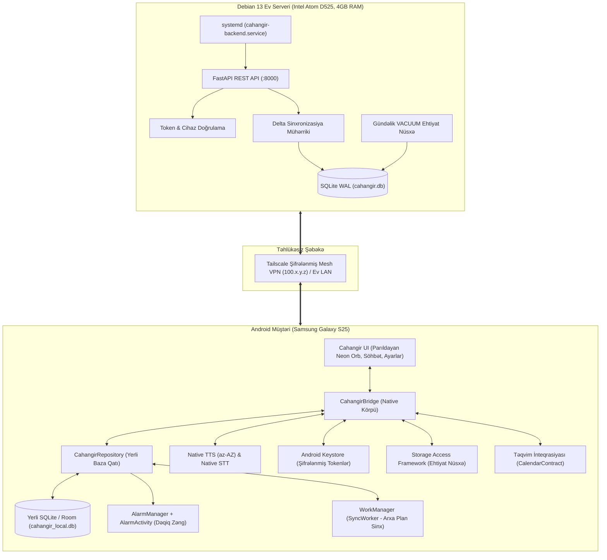
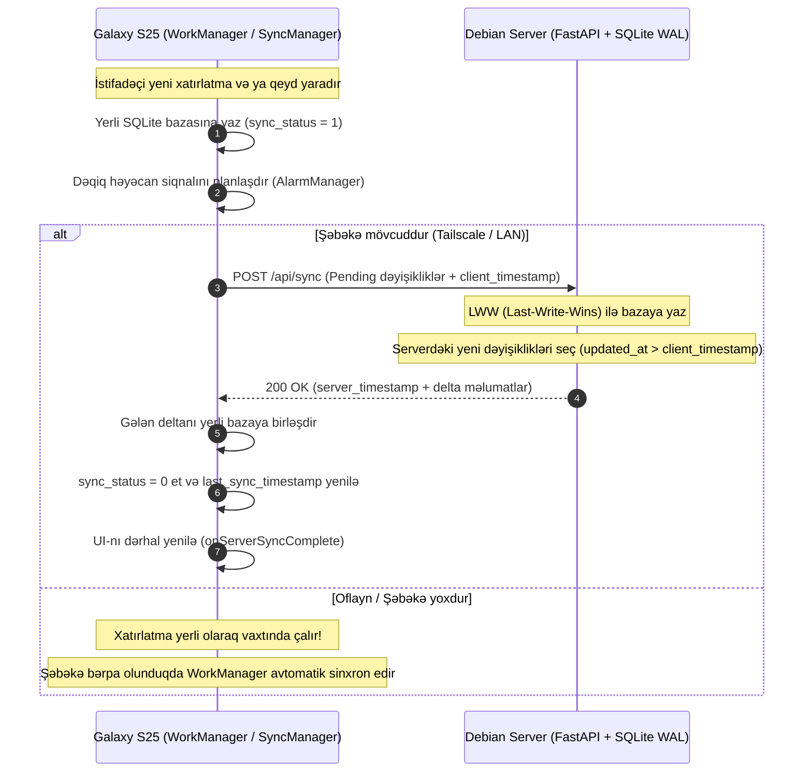

# Cahangir AI — Tam Sistem Arxitekturası və Bələdçi

Bu sənəd **Cahangir AI** şəxsi köməkçisinin mərkəzi Debian serveri və Android (Galaxy S25) tətbiqi arasındakı tam arxitektura, oflayn işləmə mexanizmi, sinxronizasiya protokolu və quraşdırma təlimatını əhatə edir.

---

## 1. Arxitektura Fəlsəfəsi və Prinsipləri

* **Oflayn-Birinci (Offline-First):** Android tətbiqi internet və ya server bağlantısı olmadan 100% müstəqil işləyir. Bütün xatırlatmalar, səsli bildirişlər, yaddaş və tapşırıqlar yerli SQLite/Room bazasında saxlanır və dəqiq həyəcan siqnalları (`AlarmManager`) ilə işləyir.
* **Mərkəzi Yaddaş və Sinxronizasiya (Debian Server):** Evdəki köhnə kompüter (Debian 13, Intel Atom D525, 4 GB RAM) mərkəzi məlumat anbarı rolunu oynayır. Gələcəkdə Windows tətbiqi və ya digər cihazlar əlavə olunduqda vahid yaddaş bu server üzərindən paylaşılır.
* **Təhlükəsiz Şəbəkə (Tailscale Mesh):** Server internetə açıq portlar tələb etmir. Bütün cihazlar təhlükəsiz, şifrələnmiş Tailscale daxili şəbəkəsi (`100.x.y.z`) və ya ev WiFi LAN-ı üzərindən əlaqə saxlayır.
* **Aşağı Resurs Sərfi (Atom D525 Optimization):** Atom D525 prosessorunda böyük dil modelləri (LLM) işlədilmir! Debian server yalnız ultra-yüngül FastAPI + SQLite xidmətini idarə edir (~35-50 MB RAM, <0.5% CPU).
* **AI Şəffaflığı və Pilləli İntellekt:**
  - *Səviyyə 1 (0ms, 0MB RAM, 100% Oflayn):* Deterministik Azərbaycan dili NLP və qaydalar mühərriki (`nlp.js`, `brain.js`). Bütün xatırlatmalar, taymerlər, riyaziyyat və qeydlər dərhal icra edilir.
  - *Səviyyə 2 (Cihazda / Masaüstündə AI):* Güclü cihazlarda (Galaxy S25 Snapdragon 8 Elite və ya masaüstü kompüter) yerli Gemma / Ollama modelləri.
* **Sıfır Əlavə Xərc:** Heç bir abunəlik, ödənişli bulud servisi (AWS/Firebase) tələb olunmur.

---

## 2. Sistem Arxitekturası Blok Sxemi



---

## 3. İkitərəfli Delta Sinxronizasiya Protokolu

Sinxronizasiya yalnız son uğurlu sinxdən sonra dəyişən məlumatları (`updated_at > last_sync_timestamp`) ötürür.



---

## 4. Debian Server Quraşdırma Təlimatı

### Addım 1: Faylları serverə yükləyin
`backend/` qovluğunu Debian serverə kopyalayın (məsələn: `/home/debian/cahangir-backend`).

### Addım 2: Avtomatlaşdırılmış quraşdırmanı işə salın
```bash
cd cahangir-backend
sudo bash setup_debian.sh
```

Bu skript:
1. `python3-venv`, `python3-pip`, `curl` paketlərini yoxlayır və quraşdırır.
2. `/opt/cahangir-backend` qovluğunda təcrid olunmuş virtual mühit (`venv`) yaradır.
3. Asılılıqları quraşdırır (`fastapi`, `uvicorn`, `pydantic`, `psutil`).
4. `/etc/systemd/system/cahangir-backend.service` faylını tənzimləyir və xidməti aktivləşdirir.
5. Server açılan kimi ekranda **Admin Pairing Token** və Tailscale IP ünvanını çap edir.

### Addım 3: Xidməti yoxlayın
```bash
sudo systemctl status cahangir-backend.service
curl http://localhost:8000/api/health
```

---

## 5. Android (Galaxy S25) Quraşdırma və Əlaqələndirmə

1. Tətbiqi telefonda açın.
2. Sol menyudan **⚙️ Ayarlar** bölməsinə keçin.
3. **🌐 Mərkəzi Debian Server (Tailscale)** kartına enin:
   - **Server URL:** `http://100.x.y.z:8000` (serverin Tailscale IP-si) və ya `http://192.168.1.102:8000` (ev WiFi-si daxilində).
   - **Admin Pairing Token:** Server quraşdırılarkən verilən unikal açar.
4. **🔗 Serverə Qoş** düyməsinə klikləyin:
   - Tətbiq serverlə əlaqə quracaq, unikal şifrələnmiş cihaz tokeni alacaq və onu **Android Keystore**-da təhlükəsiz saxlayacaq.
   - Yaşıl rəngdə *"✓ Qoşulub: http://... (Son sinx: ...)"* statusu görünəcək.
5. Bundan sonra hər hansı qeyd və ya xatırlatma əlavə edildikdə:
   - Telefonda dərhal saxlanır,
   - Şəbəkə varsa, 1 saniyə içində Debian serverə ötürülür,
   - Şəbəkə yoxdursa, oflayn növbəyə alınır və əlaqə bərpa olunan kimi fon rejimində (`WorkManager`) ötürülür.

---

## 6. Resurs və Təhlükəsizlik Xülasəsi

| Sahə | Tətbiq | Resurs Xərci |
|---|---|---|
| **Debian Backend** | FastAPI + SQLite WAL | 35 – 50 MB RAM, <0.5% CPU (Atom D525 üçün idealdır) |
| **Android Baza** | Yerli SQLite / Room | < 5 MB yaddaş, ani oxuma/yazma |
| **Fon İşi** | WorkManager (Constraint: CONNECTED) | Batareyanı tükətməyən hadisə-əsaslı sinx |
| **Təhlükəsizlik** | Android Keystore + Device Bearer Tokens | Heç bir açıq şifrəsiz saxlanc yoxdur |
| **Fayl Əməliyyatları** | Storage Access Framework (SAF) | İcazə tələb etməyən təhlükəsiz sənəd seçici |
| **Təqvim** | CalendarContract | Yalnız istifadəçi təsdiq etdikdə təqvimə yazır |
| **Oflayn Zəng** | AlarmManager exact wakeup | Ekran sönülü/tətbiq bağlı olsa belə səsli oxuyur |
